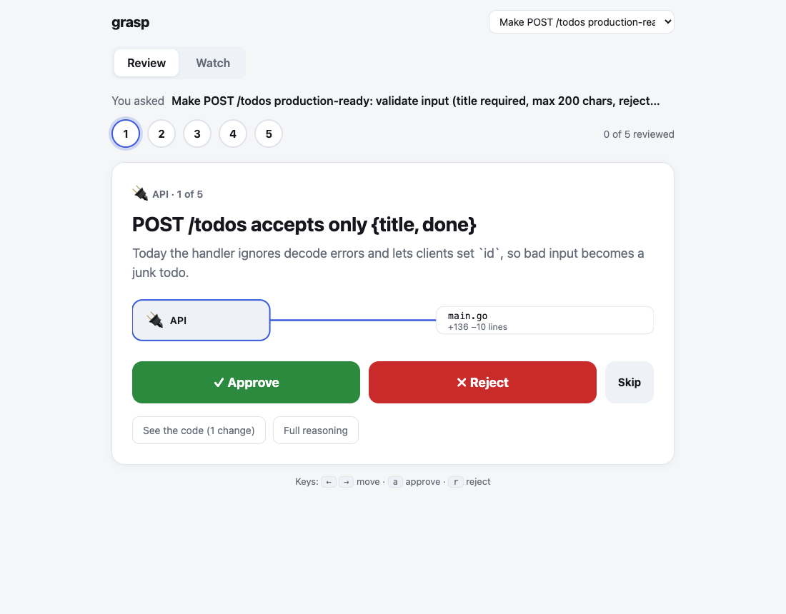
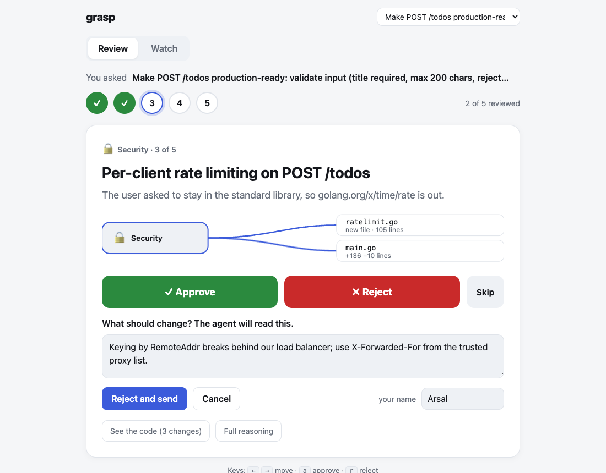
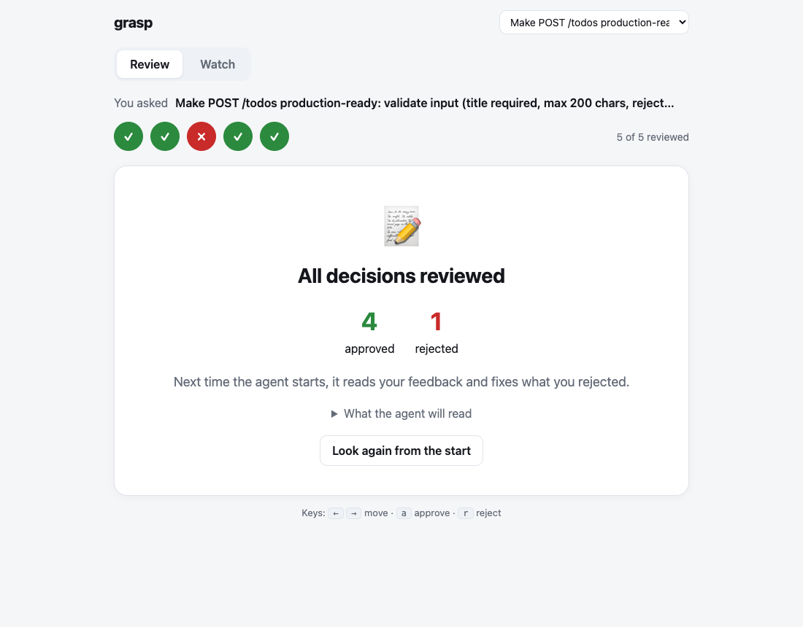
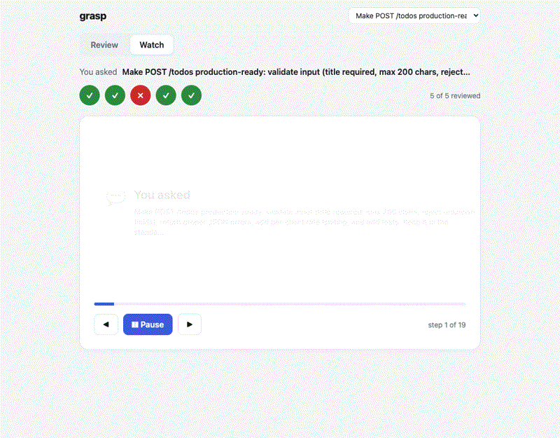

# grasp

**Review what your coding agent did, decision by decision.**

AI agents now write code faster than people can review it. A 2,000-line diff hides the things a reviewer
actually needs to judge: *it added a cache here, it changed the refund rule, it pulled in a new library.*
grasp turns an agent's session into those decisions and shows them **one at a time**: a short headline, one
sentence of why, a picture of the files it touched, and two big buttons. Rejections go back to the agent.



| Reject with a note for the agent | When you are done |
|---|---|
|  |  |

<details><summary><b>Watch</b> mode: the session as one sentence at a time</summary>


</details>

## How it works

```
 you ask ──► agent decides ──► agent changes files
    │             │                    │
    └──── grasp reads the session (hooks + transcript) ────┐
                  │                                         │
     agent calls record_decision (MCP)            every edit is linked to
     "what, why, files, alternatives, risk"       the decision that explains it
                  │                                         │
                  └────────► review page ◄──────────────────┘
                     approve · reject · comment
                                │
     agent calls get_review_feedback (MCP) and follows it next time
```

- **Decisions, not lines.** Each decision shows *why*, the options the agent rejected, the risk it saw, and
  the exact changes that carry it out.
- **Nothing hides.** Edits that no decision explains are grouped as *changes with no recorded reason*.
  Files a decision names but never touches are flagged as *unverified claims*.
- **Works without cooperation too.** If the agent records no decisions, grasp groups edits by what the agent
  said just before making them, and marks those groups as inferred.
- **One thing at a time.** Each decision is a card; the code and the full reasoning stay hidden until you
  ask for them. **Watch** plays the session as one sentence per step.
- **Closes the loop.** Rejections and comments become instructions the agent reads through
  `get_review_feedback` at the start of its next task.

## Quick start (Claude Code)

```sh
go install github.com/arsaljamal/grasp/cmd/grasp@latest
cd your-project
grasp init      # adds the MCP server (.mcp.json), hooks (.claude/settings.json) and a CLAUDE.md note
claude          # work as usual
grasp serve     # open http://127.0.0.1:7080 and review; it updates live while the agent works
```

Already have sessions? `grasp import --latest` loads the newest Claude Code session for this folder, or pass
transcript files: `grasp import ~/.claude/projects/<project>/<session>.jsonl`.

## Commands

| Command | What it does |
|---|---|
| `grasp init` | Set up Claude Code in this project. Merges into existing config files, never overwrites them. |
| `grasp serve [-addr]` | The review page, on 127.0.0.1:7080 by default. |
| `grasp import` | Load Claude Code transcripts. |
| `grasp feedback` | Print reviewer feedback as Markdown instructions (the same text the agent gets). |
| `grasp mcp` | The MCP server the agent starts: `record_decision`, `get_review_feedback`. |
| `grasp hook` | Claude Code hook entry point. Always exits 0, so it never blocks the agent. |

State lives in `.grasp/` in your project: parsed sessions, `reviews.json` (commit it to share verdicts with
your team) and `decisions.jsonl` (decisions from agents grasp has no transcript for).

## Other agents

Any MCP-capable agent can call `record_decision` and `get_review_feedback`; those decisions show up in an
*agent log* session. Full timelines (edits, commands, Watch mode) currently come from Claude Code transcripts.
Adapters for other agents' logs are welcome.

## Status

Early, and built in the open. Tested end to end with Claude Code on a sample service
([docs/example.md](docs/example.md)). Ideas next: checking decisions against a written spec, a GitHub PR
check that blocks merges with rejected decisions, and team views across many sessions.

## License

MIT
