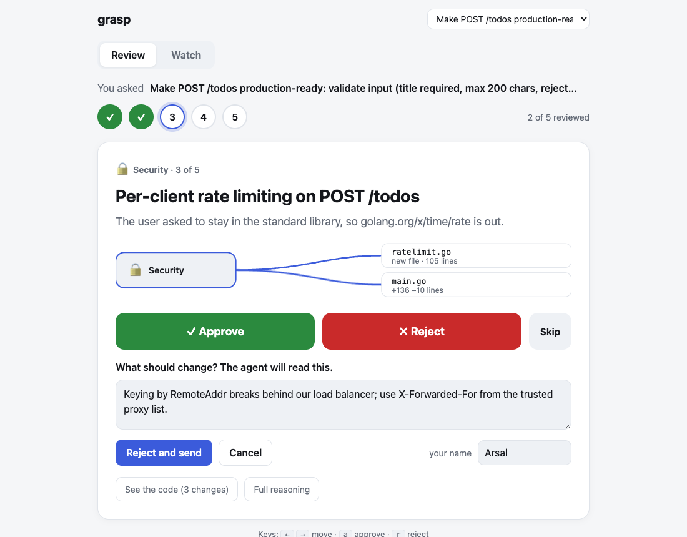

# Example: one review round with Claude Code

A real run on a small Go service (a to-do API with no validation, no error format and no rate limiting).
Nothing here is staged: these are the decisions Claude Code recorded and what grasp did with them.

## 1. The task

```sh
grasp init
claude -p "Make POST /todos production-ready: validate input (title required, max 200 chars, reject unknown fields), return proper JSON errors, add per-client rate limiting, and add tests. Keep it in the standard library."
```

Claude recorded five decisions through `record_decision` while it worked:

| Kind | Decision | Files |
|---|---|---|
| api | POST /todos accepts only `{title, done}`; title trimmed, required, ≤200 characters; unknown fields, trailing data, oversized bodies and non-JSON content types rejected | main.go |
| api | All error responses use a JSON envelope `{"error":{"code","message"}}` | main.go |
| security | Per-client rate limiting: hand-rolled token bucket keyed by RemoteAddr IP (5 req/s, burst 10), 429 + Retry-After | ratelimit.go, main.go |
| architecture | `http.Server` with read/write/idle timeouts and a `newServer()` constructor | main.go |
| testing | Table-driven httptest tests through the real mux, fake-clock limiter tests, a concurrent test under `-race` | main_test.go, ratelimit_test.go |

grasp linked all 5 edits to these decisions: no unexplained changes, no unverified claims. Three decisions
were carried out by one rewrite of `main.go`, and grasp credits that edit to all three.

## 2. The review

The rate-limiting decision listed its own risk: *behind a load balancer every client shares the proxy's IP.*
For a service that runs behind a load balancer that is a real problem, so the reviewer rejected it:

> Keying by RemoteAddr breaks behind our load balancer; use X-Forwarded-For from the trusted proxy list.



## 3. The agent reads the verdict

```sh
claude -p "Check reviewer feedback on your earlier work and address it."
```

Claude called `get_review_feedback`, got the rejection with the comment, recorded a new decision
(*Rate-limit key: client IP from X-Forwarded-For, trusting only configured proxy CIDRs*) with its reasoning,
rejected alternatives and risks, and changed four files. All 36 tests passed with `-race`. In grasp the new
session shows "Claude read reviewer feedback" as its first step, then the decision and its 15 edits.

Cost of both runs: about $1.30 of model usage.

## 4. Show, don't tell (added later)

On a fresh copy of the same service, with `show_behavior` available, Claude recorded 4 decisions and
demonstrated 2 of them. grasp ran each example on the original code and on the new code:

| Example | Before | Now |
|---|---|---|
| Burst past 10 requests | `201` ×12 | `201` ×10, then `429` with `Retry-After: 1` |
| `{"done":true}` (no title) | `201`, saved a todo with an empty title | `400 title is required` |
| `{"id":99,"title":"x"}` | `201`, client chose its own id | `400 unknown field "id"` |

The tests decision had no example, and grasp says so on its card.

## 5. What it could break (added later)

A second file, a bulk importer, shares the `validateTitle` helper with POST /todos.

- **"Stricter titles on POST /todos":** Claude added a separate check for POST only and left the shared
  helper alone. grasp reported no ripple (correct), and flagged that an existing test was changed.
  An early version raised a false alarm here; it now looks only at lines that actually changed.
- **"Collapse repeated spaces in titles":** Claude changed `validateTitle` itself. grasp flagged that
  `importer.go:15` uses it and was not touched, so bulk imports now behave differently too.
